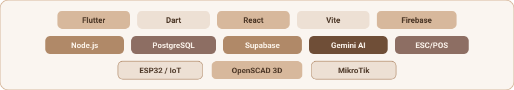

  

---

### About Me

Hi, I'm **Nurmiyaty (Miya)** — a final-year **Information Technology** student at **UIN Antasari Banjarmasin** and **Business Development Intern** at **PT Yassa Pratama Abadi** (working on ERP, POS, and CRM solutions).

- **Focus Areas:** Offline-First Mobile Apps, Hybrid AI (On-Device + Cloud), Full-Stack Web Systems, and ESP32 IoT Automation.
- **Current Highlight:** Developing **Nusantara Hybrid POS**, a 5-role blackout-resilient POS ecosystem powered by Flutter, Gemini AI, Local LAN Server sync, and WhatsApp CRM.
- **Live Portfolio:** soon

---

### Featured Projects

| Project | Description | Tech Stack |
| :--- | :--- | :--- |
| **Nusantara Hybrid POS** | 5-role POS ecosystem (Cashier, Kitchen Auto-Print, Queue Display, Customer QR Tracker, Hardware Hub) with Hybrid AI and zero-internet blackout failover. | `Flutter` `Firebase` `Gemini AI` `ESC/POS` |
| **Smart Riayah** | Integrated student leave & visitor security platform with automated WhatsApp notifications, QR E-Coupons, and ESP32-S3 RFID turnstile hardware. | `React` `Node.js` `PostgreSQL` `ESP32-S3` |
| **Antasari Mart** | Campus e-commerce web & mobile app integrated with Midtrans payment gateway and an automated ESP32 stepper-motor vending machine prototype. | `Flutter` `React` `Midtrans` `ESP32` |

---

### Tech Stack

  

